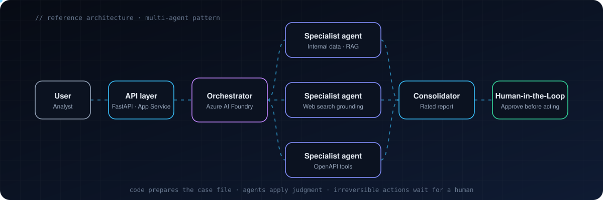

  

  
  
  

  

## 👋 About me

I'm a Systems Engineer from Perú 🇵🇪 specialized in Artificial Intelligence. I build **end-to-end AI solutions on Microsoft Azure**: document ingestion, hybrid retrieval, agent orchestration, APIs and production deployment.

<table>
<tr>
<td width="50%" valign="top">

**🤖 Multi-agent systems** 
Orchestrators and specialist agents on Azure AI Foundry and Microsoft Agent Framework, with Human-in-the-Loop where decisions are irreversible.

</td>
<td width="50%" valign="top">

**📚 Multimodal RAG** 
Hybrid search, semantic ranking and answers with citations traceable to the source document.

</td>
</tr>
<tr>
<td width="50%" valign="top">

**📄 Document AI** 
Structured extraction from contracts, IDs, legal powers and financial documents with Document Intelligence + LLMs.

</td>
<td width="50%" valign="top">

**☁️ Cloud-native delivery** 
App Service, Functions, Container Apps and AKS, secured with Key Vault and Entra ID, observed with Application Insights.

</td>
</tr>
</table>

> 💬 **Try it:** my [portfolio](https://jhonatanrc03.pythonanywhere.com/) has an AI assistant that knows my CV. Ask it anything about my experience.

## 🧠 How I design multi-agent systems

  

## 🚀 What I've built in production

Enterprise solutions delivered at **Gestión de Sistemas** (Jan 2025 – present). The code is private; architectures and design decisions are documented in my [portfolio](https://jhonatanrc03.pythonanywhere.com/).

<b>🤖 Multi-agent systems</b>

 

| Project | What it does | Key stack |
|---|---|---|
| **Risk Agents** | An orchestrator splits credit-risk evaluation across agents for history, macro/sector context (web grounding) and financial ratios (OpenAPI tools), then consolidates a rated report. | AI Foundry · Azure OpenAI · Functions · FastAPI · React |
| **Corporate Credit Risk Agents** | A code-driven orchestrator coordinates six agents (financial, sector, prior reports, charts, report writer and validator) to produce a corporate-banking credit report, exportable to Word and PowerPoint. | Microsoft Foundry · Agent Framework · MCP · AI Search · Document Intelligence · Cosmos DB |
| **Dispute Management Agents** | Six sequential agents automate card disputes from intake to resolution, with a mandatory human approval gate before chargebacks. | AI Foundry Hosted Agents · Agent Framework · Container Apps |
| **Transactional Fraud** | An analyst agent weighs customer-behavior evidence and issues a risk verdict justified factor by factor for human review. | AI Foundry · Container Apps · Cosmos DB · Entra ID |

<b>📚 RAG & knowledge platforms</b>

 

| Project | What it does | Key stack |
|---|---|---|
| **AVI — Document Chatbot** | Natural-language Q&A over institutional documents with hybrid search, semantic ranker and source citations. | Azure OpenAI · GPT-4 Vision · AI Search · Cosmos DB |
| **Document Knowledge** | Enterprise knowledge platform on AKS that decouples batch ingestion from a low-latency chat service. | AKS · Semantic Kernel · AI Search · Cosmos DB |
| **Helpdesk Assistant** | Support desk that answers incidents citing the exact procedure from indexed manuals. | Azure OpenAI · AI Search · Application Insights |
| **Smart Recruiting** | Automated CV analysis that extracts candidate profiles and ranks them semantically. | Document Intelligence · AI Search · OpenAI |

<b>📄 Document AI</b>

 

| Project | What it does | Key stack |
|---|---|---|
| **Document Processor** | Serverless extraction of key fields from contracts, tax IDs, national IDs and promissory notes, with SFTP sync and signature validation. | Functions · Document Intelligence · Logic Apps |
| **Legal Powers Analyzer** | Extracts attorneys-in-fact, powers, amount limits and validity from legal deeds and generates downloadable summaries. | Azure OpenAI · Document Intelligence · Key Vault |

## 🛠️ Tech stack

  
  
  
  
  
   
  
  
  
  
  

  
   
  

<b>Full stack by area</b>

 

| Area | Tools |
|---|---|
| **Agentic AI & orchestration** | Model Context Protocol (MCP) · Microsoft Agent Framework · Semantic Kernel · Azure AI Foundry · Human-in-the-Loop |
| **Generative AI & NLP** | Hybrid RAG + semantic ranking · Azure OpenAI (GPT-4, embeddings) · OpenAI APIs · Prompt engineering |
| **Document AI & vision** | Azure AI Document Intelligence · Content Understanding · GPT Vision · YOLOv8 · OpenCV · TensorFlow · Keras |
| **Azure cloud** | AI Search · App Service · Functions · Container Apps · AKS · Logic Apps · Key Vault · Application Insights |
| **Backend & frontend** | Python · FastAPI · Flask · Quart · JavaScript / TypeScript · React · Angular |
| **Data** | Pandas · NumPy · scikit-learn · PySpark · Databricks · Power BI · SQL |
| **Databases** | Cosmos DB · PostgreSQL · SQL Server · MongoDB · MySQL |

## 🏅 Microsoft certifications

| Exam | Certification | Level | Credential |
|:---:|---|:---:|:---:|
|  | **Azure AI Apps and Agents Developer** | Associate | [Verify ↗](https://learn.microsoft.com/api/credentials/share/es-es/JhonatanRodriguezCustodio-7265/D800CFD829806D6D?sharingId=741F47D64D5A545A) |
|  | **Azure AI Engineer** | Associate | [Verify ↗](https://learn.microsoft.com/api/credentials/share/es-es/JhonatanRodriguezCustodio-7265/8AA0D450EA13F82D?sharingId=741F47D64D5A545A) |
|  | **Azure Data Scientist** | Associate | [Verify ↗](https://learn.microsoft.com/api/credentials/share/es-es/JhonatanRodriguezCustodio-7265/1658F7EFBA648D3E?sharingId=741F47D64D5A545A) |
|  | **AI Transformation Leader** | Professional | [Verify ↗](https://learn.microsoft.com/api/credentials/share/es-es/JhonatanRodriguezCustodio-7265/96D3C54F9F20FAE5?sharingId=741F47D64D5A545A) |
|  | **AI Business Professional** | Professional | [Verify ↗](https://learn.microsoft.com/api/credentials/share/es-es/JhonatanRodriguezCustodio-7265/BA8640C8A29E6650?sharingId=741F47D64D5A545A) |
|  | **Azure AI Fundamentals** | Fundamentals | [Verify ↗](https://learn.microsoft.com/api/credentials/share/es-es/JhonatanRodriguezCustodio-7265/4298E8369C4AE17A?sharingId=741F47D64D5A545A) |
|  | **Azure Data Fundamentals** | Fundamentals | [Verify ↗](https://learn.microsoft.com/api/credentials/share/es-es/JhonatanRodriguezCustodio-7265/E334CB8251A8D2B8?sharingId=741F47D64D5A545A) |

## 💼 Experience

| | Role | Highlights |
|---|---|---|
| **Jan 2025 – present** | **AI Engineer** · Gestión de Sistemas · Perú | Design and delivery of RAG, document-AI and multi-agent solutions for enterprise clients in banking, finance, legal and HR, deployed on Azure. |
| **Jul 2024 – Dec 2024** | **Data Science & Analytics Jr** · Shintek · Spain | Improved object-detection precision and efficiency by 20% with YOLO and transfer learning. Built KPI dashboards and prepared data for predictive models. |

**🎓 Community:** Mentor at the GenAI Hackathon Interbank (Nov 2025) and the Bago Hackathon on Azure AI Foundry (Jun 2026) · Instructor of an Azure AI Foundry workshop at Habitat (Aug 2026)

---

  <b>Open to AI Engineer opportunities</b> · GenAI, RAG and agentic systems on Azure 
  <a href="https://www.linkedin.com/in/jrc03/">LinkedIn</a> · <a href="mailto:jhonatan9494@gmail.com">jhonatan9494@gmail.com</a> · <a href="https://jhonatanrc03.pythonanywhere.com/">Portfolio</a>

