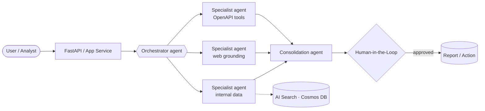

<h1 align="center">Jhonatan Rodriguez Custodio</h1>

  <b>AI Engineer · Azure & Generative AI</b> 
  I design and ship multimodal RAG systems and multi-agent architectures that run in production.

  
  
  

  
  
  
  

---

### About me

Systems Engineer specialized in Artificial Intelligence. I build end-to-end AI solutions on Microsoft Azure: from document ingestion and hybrid retrieval to agent orchestration, APIs and production deployment.

- 🤖 **Multi-agent systems** on Azure AI Foundry and Microsoft Agent Framework, with Human-in-the-Loop where decisions are irreversible.
- 📚 **Multimodal RAG**: hybrid search, semantic ranking and answers with citations traceable to the source document.
- 📄 **Document AI**: structured extraction from contracts, IDs, legal powers and financial documents with Document Intelligence + LLMs.
- ☁️ **Cloud-native delivery**: App Service, Functions, Container Apps and AKS, secured with Key Vault and Entra ID and observed with Application Insights.
- 🎓 Mentor at GenAI hackathons and instructor of Azure AI Foundry workshops.

> 💬 My [portfolio](https://jhonatanrc03.pythonanywhere.com/) has an AI assistant that knows my CV. Ask it anything about my experience.

---

### What I've built in production

Corporate solutions developed at **Gestión de Sistemas** (Jan 2025 – present). Code is private; architectures and design decisions are documented in my [portfolio](https://jhonatanrc03.pythonanywhere.com/).

| Project | Type | What it does | Key stack |
|---|---|---|---|
| **Risk Agents** | Multi-agent | An orchestrator splits credit-risk evaluation across agents for history, macro/sector context (web grounding) and financial ratios (OpenAPI tools), then consolidates a rated report. | AI Foundry · Azure OpenAI · Functions · FastAPI · React |
| **Dispute Management Agents** | Multi-agent | Six sequential agents automate card disputes, from intake to resolution, with a mandatory human approval gate before chargebacks. | AI Foundry Hosted Agents · Agent Framework · Container Apps |
| **Transactional Fraud** *(in development)* | Agent | An analyst agent weighs customer-behavior evidence and issues a risk verdict justified factor by factor for human review. | AI Foundry · Container Apps · Cosmos DB · Entra ID |
| **AVI — Document Chatbot** | Multimodal RAG | Natural-language Q&A over institutional documents with hybrid search, semantic ranker and source citations. | Azure OpenAI · GPT-4 Vision · AI Search · Cosmos DB |
| **Document Knowledge** | Cloud architecture | Enterprise knowledge platform on AKS that decouples batch ingestion from a low-latency chat service. | AKS · Semantic Kernel · AI Search · Cosmos DB |
| **Helpdesk Assistant** | RAG | Support desk that answers incidents citing the exact procedure from indexed manuals. | Azure OpenAI · AI Search · Application Insights |
| **Document Processor** | Document AI | Serverless extraction of key fields from contracts, tax IDs, national IDs and promissory notes, with SFTP sync and signature validation. | Functions · Document Intelligence · Logic Apps |
| **Legal Powers Analyzer** | Document AI | Extracts attorneys-in-fact, powers, amount limits and validity from legal deeds and generates downloadable summaries. | Azure OpenAI · Document Intelligence · Key Vault |
| **Smart Recruiting** | AI search | Automated CV analysis that extracts candidate profiles and ranks them semantically. | Document Intelligence · AI Search · OpenAI |

<b>Reference architecture: how my multi-agent systems are shaped</b>

 

Every agent works on an explicit data contract. Code prepares the case file, the agent applies judgment, and irreversible actions always pass through human approval.

---

### Tech stack

**AI & agents** 

**Document AI & computer vision** 

**Azure cloud** 

**Backend & frontend** 

**Data & databases** 

---

### Microsoft certifications

| | Certification | Level |
|---|---|---|
|  | [Azure AI Engineer Associate](https://learn.microsoft.com/api/credentials/share/es-es/JhonatanRodriguezCustodio-7265/8AA0D450EA13F82D?sharingId=741F47D64D5A545A) | Associate |
|  | [Azure Data Scientist Associate](https://learn.microsoft.com/api/credentials/share/es-es/JhonatanRodriguezCustodio-7265/1658F7EFBA648D3E?sharingId=741F47D64D5A545A) | Associate |
|  | [AI Transformation Leader](https://learn.microsoft.com/api/credentials/share/es-es/JhonatanRodriguezCustodio-7265/96D3C54F9F20FAE5?sharingId=741F47D64D5A545A) | Professional |
|  | [AI Business Professional](https://learn.microsoft.com/api/credentials/share/es-es/JhonatanRodriguezCustodio-7265/BA8640C8A29E6650?sharingId=741F47D64D5A545A) | Professional |
|  | [Azure AI Fundamentals](https://learn.microsoft.com/api/credentials/share/es-es/JhonatanRodriguezCustodio-7265/4298E8369C4AE17A?sharingId=741F47D64D5A545A) | Fundamentals |
|  | [Azure Data Fundamentals](https://learn.microsoft.com/api/credentials/share/es-es/JhonatanRodriguezCustodio-7265/E334CB8251A8D2B8?sharingId=741F47D64D5A545A) | Fundamentals |

---

### Experience

**AI Engineer** · Gestión de Sistemas · Perú · *Jan 2025 – present* 
Design and delivery of RAG, document-AI and multi-agent solutions for enterprise clients in banking, finance, legal and HR, deployed on Azure.

**Data Science & Analytics Jr** · Shintek · Spain (remote) · *Jul 2024 – Dec 2024* 
Improved object-detection precision and efficiency by 20% with YOLO and transfer learning. Built KPI dashboards and prepared data for predictive models.

**Community** 
Mentor at the GenAI Hackathon Interbank (Nov 2025) and the Bago Hackathon on Azure AI Foundry (Jun 2026) · Instructor of an Azure AI Foundry workshop at Habitat (Aug 2026)

---

### Featured public repositories

| Repository | Description |
|---|---|
| [CV-Jhonatan-Rodriguez-Custodio](https://github.com/JhonatanRC03/CV-Jhonatan-Rodriguez-Custodio) | My portfolio: Flask + vanilla JS with a streaming AI assistant on Azure AI Foundry, per-IP rate limiting and data-driven architecture diagrams. |
| [taller-azure-ia](https://github.com/JhonatanRC03/taller-azure-ia) | Hands-on Azure AI workshop: step-by-step labs and a chat app. |
| [fraud_detect](https://github.com/JhonatanRC03/fraud_detect) | Machine-learning model for fraud detection. |
| [Credit-Scoring-Prediction](https://github.com/JhonatanRC03/Credit-Scoring-Prediction) | Credit-default probability model for a financial institution. |
| [practica-mlops](https://github.com/JhonatanRC03/practica-mlops) · [despliegue-ml](https://github.com/JhonatanRC03/despliegue-ml) | MLOps practice and cloud deployment examples for ML models. |

---

  <b>Open to AI Engineer opportunities</b>: GenAI, RAG and agentic systems on Azure. 
  <a href="https://www.linkedin.com/in/jrc03/">LinkedIn</a> · <a href="mailto:jhonatan9494@gmail.com">jhonatan9494@gmail.com</a> · <a href="https://jhonatanrc03.pythonanywhere.com/">Portfolio</a>

